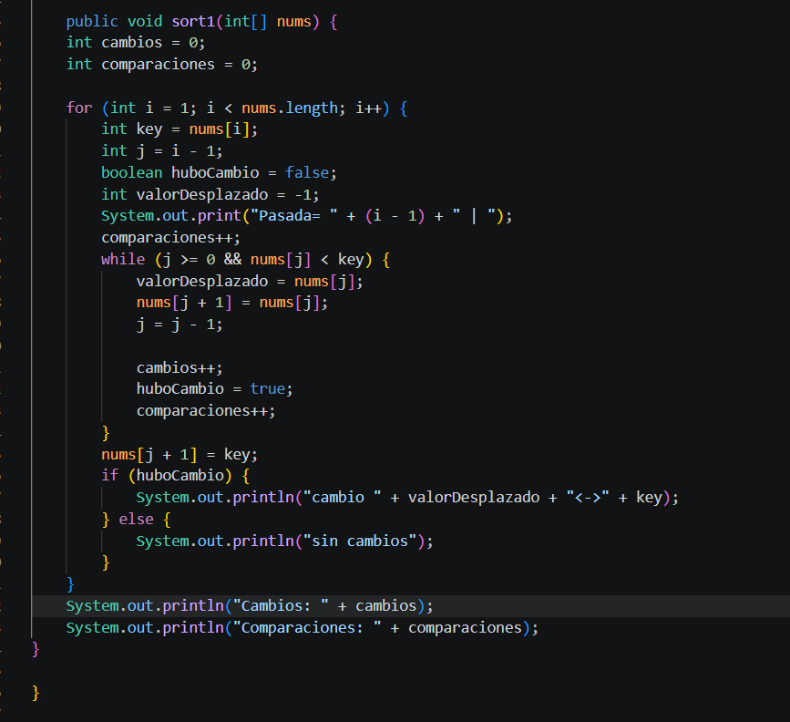

Codigo:

Consola:

Explicacion:

El código ordena un arreglo de mayor a menor utilizando Insertion Sort, 
comparando cada elemento con los anteriores para desplazar los números más 
pequeños a la derecha e insertar la clave en su lugar correcto.
