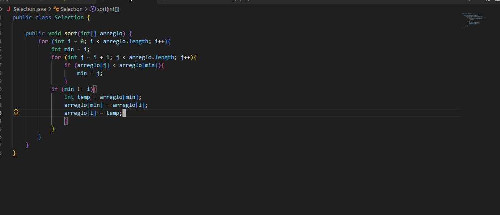
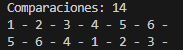

# PC 1.1.2
Codigo

Explicacion:
El codigo busca al menor de un arreglo, lo seleccciona y sigue su busqueda sin
intercambiar nada hasta el final, despues de acabar la busqueda empieza a 
intercambiar de forma ascendente.
Captura
